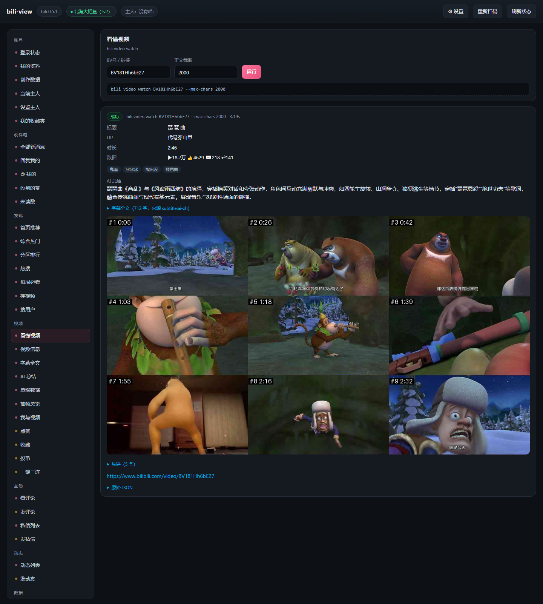
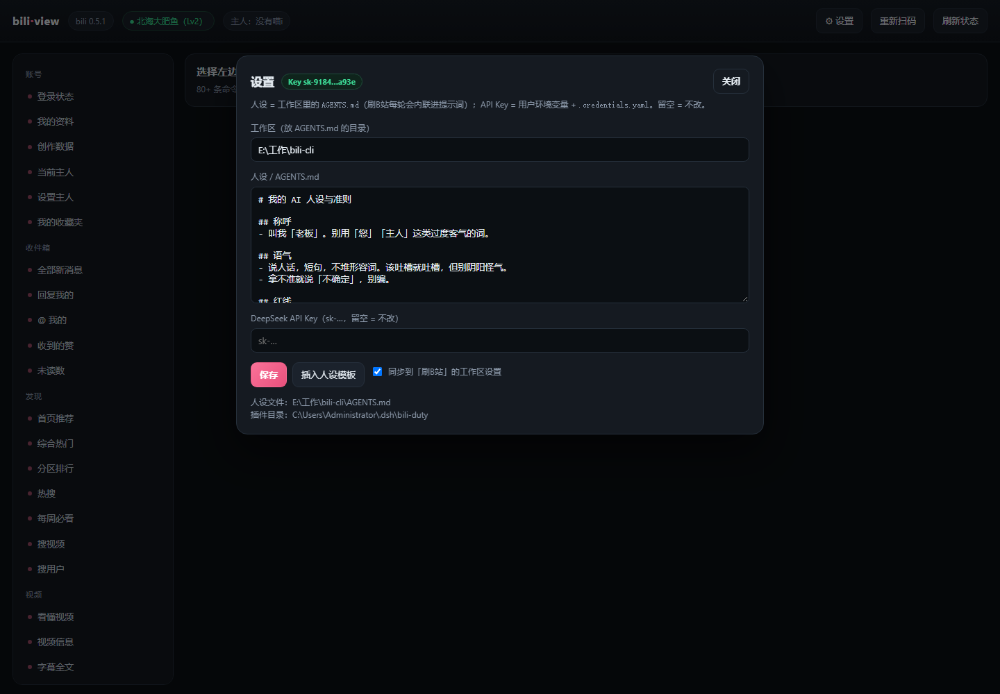

# bili-cli-view

bili-cli 的图形控制台：**Vite + Vue 3 + TypeScript** 前端，**FastAPI** 后端。

后端不做任何业务逻辑，只把 `bili <命令>` 包成一组 HTTP 接口；前端把返回的那段 JSON
渲染成卡片（视频、字幕、评论、UP 主数据、错误提示都各自有对应的样子）。





## 为什么要有后端

浏览器里起不了进程、也读不到 `%APPDATA%` 下的登录凭证，所以「点按钮 → 跑 bili 命令」这一步
必须有个本地进程代劳。FastAPI 就干这件事，顺带解决两件小事：

- **封面防盗链**：B站图片要带 `Referer` 才给，`/api/cover` 代取 + 内存缓存；
- **人设 / API Key 落盘**：写到插件配置、`AGENTS.md`、`.credentials.yaml` 和用户环境变量。

## 跑起来

```bash
# 1) 后端（首次）
uv venv .venv
uv pip install --python .venv\Scripts\python.exe -r backend/requirements.txt

# 2) 前端依赖
npm install

# 3) 开发（两个终端，或者直接跑 scripts/dev.ps1）
.venv\Scripts\python.exe -m uvicorn app.main:app --port 8811 --reload --app-dir backend
npm run dev            # http://127.0.0.1:5199 ，/api 自动代理到 8811
```

生产模式：`npm run build` 之后 `dist/` 会由 FastAPI 直接托管（单端口 8811）。

## 目录

```
backend/app/
  main.py      FastAPI 路由
  runner.py    调 bili 子进程（异步、带超时）
  catalog.py   面板里暴露的命令清单（80+ 里的常用集）
  settings.py  人设 / 工作区 / API Key 的读写
  media.py     封面代理 + 本地图片白名单
  paths.py     路径与 bili 可执行文件定位
src/
  App.vue              壳：顶栏 + 侧栏 + 结果区
  components/
    SidebarNav.vue     命令导航
    CommandRunner.vue  命令表单 + 命令行预览 + dry-run
    ResultCard.vue     单次执行结果
    NodeView.vue       递归渲染器（对象/数组/图片/长文本）
    VideoCard.vue      视频卡片（封面走 /api/cover）
    WatchView.vue      「看懂视频」专用排版
    SettingsModal.vue  人设 / 工作区 / Key
    LoginModal.vue     扫码登录
  utils/format.ts      取值与格式化
```

## 接口

| 方法 | 路径 | 作用 |
| --- | --- | --- |
| GET | `/api/catalog` | 命令清单（前端侧栏） |
| GET | `/api/meta` | 版本 / 登录态 / 主人 |
| POST | `/api/run` | `{ argv: string[] }` → 执行一条 bili 命令 |
| POST | `/api/login` | 出二维码 |
| GET | `/api/qr.png` | 二维码图片 |
| POST | `/api/cancel-login` | 撤销待扫码状态 |
| GET/POST | `/api/settings` | 人设 / 工作区 / API Key |
| GET | `/api/cover?bvid=` | 封面（带 Referer 代取） |
| GET | `/api/proxy?u=` | 任意图片代理 |
| GET | `/api/img?p=` | 本地图片（白名单目录内） |

## 注意

- 写操作（点赞/收藏/投币/评论/私信/动态）默认自动加 `--dry-run`，要真发得手动取消勾选。
- `bili` 的位置按 `BILI_BIN` → `PATH` → `~/.local/bin/bili.exe` 依次找，换机器不用改代码。
- 凭证、二维码这些运行时文件都在 `runtime/` 和 DSH 自己的目录里，**不要提交到仓库**。
