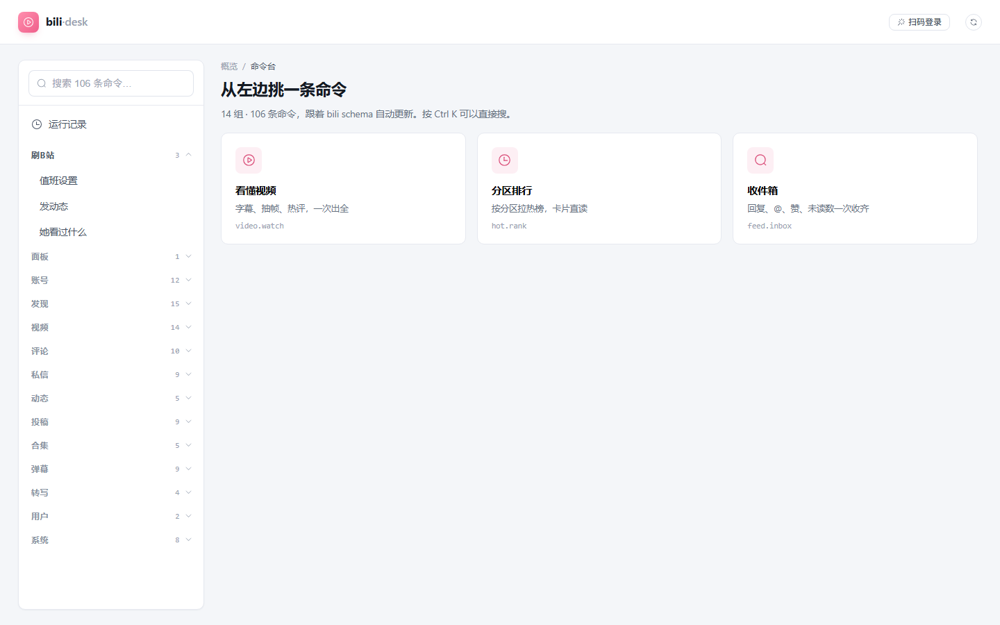
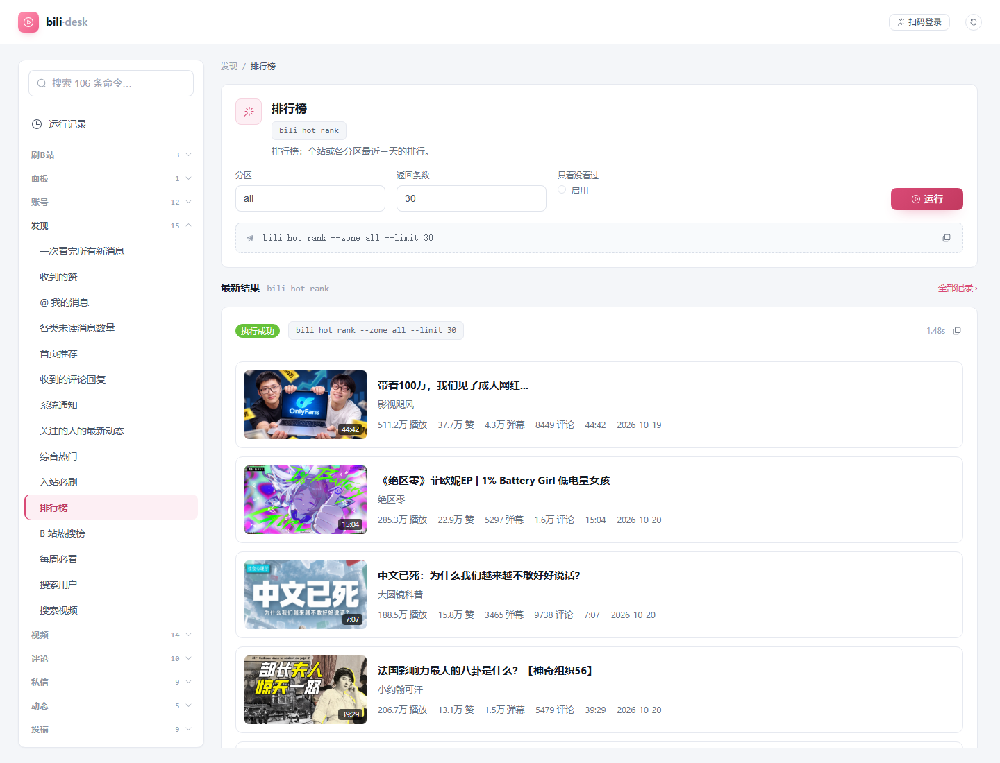
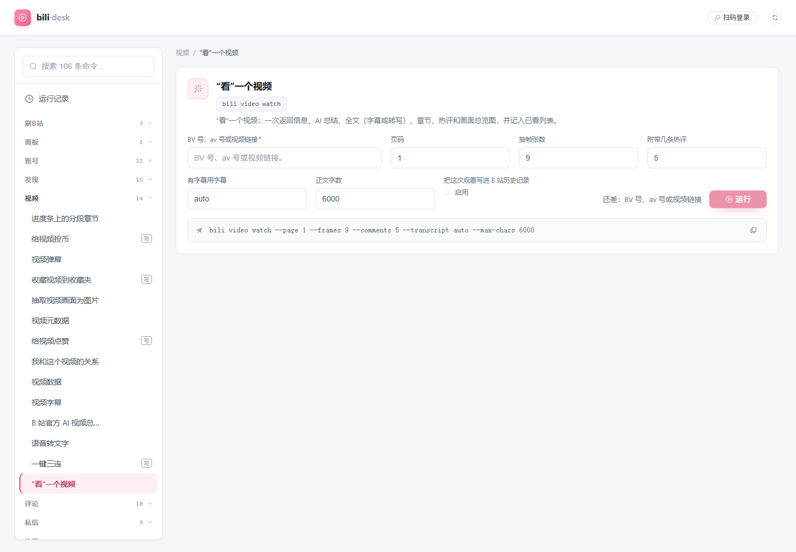
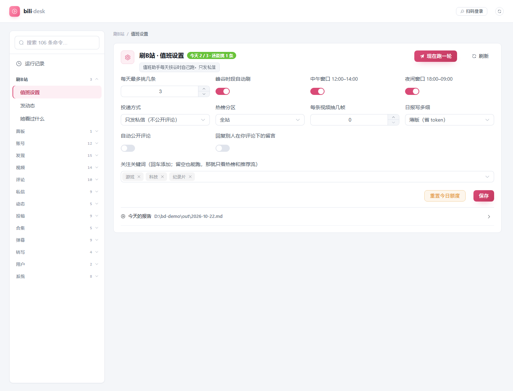
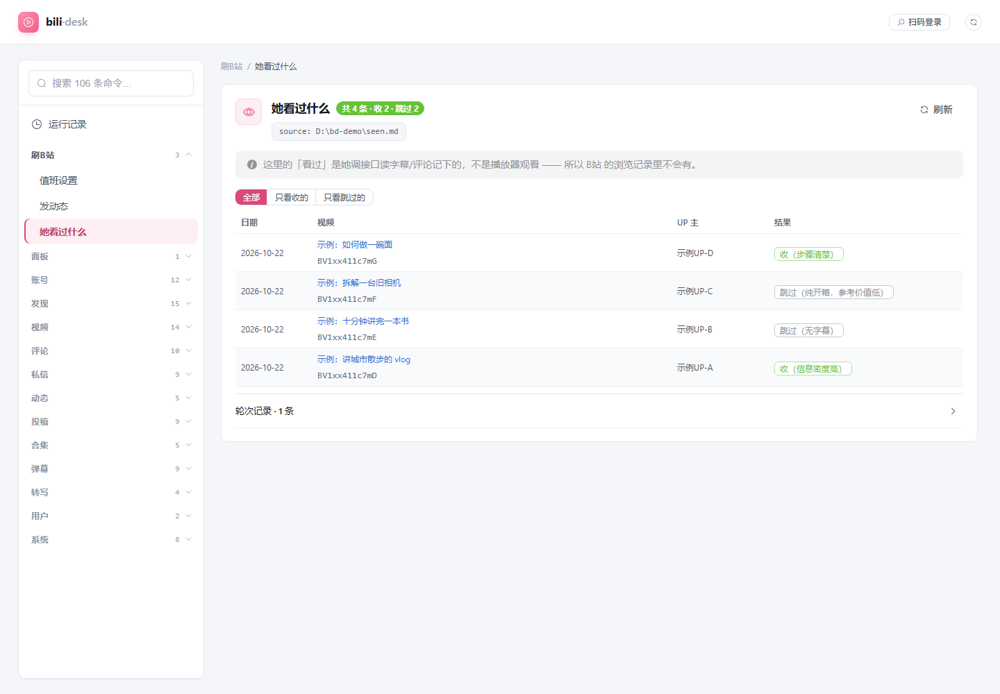

# bili-desk

bili-cli 的图形控制台：**Vite + Vue 3 + TypeScript + Element Plus** 前端，**FastAPI** 后端。

后端不做业务逻辑，只把 `bili <命令>` 包成一组 HTTP 接口；前端用 Element Plus 的表单、弹窗、消息、
折叠面板把返回的 JSON 渲染成卡片和图谱。





> 截图里的账号信息已隐去（`?demo=1` 会隐藏顶栏的版本/账号/主人三个 chip）。

## 命令表跟着 schema 走

侧栏不是手写的固定清单：后端每次（缓存 5 分钟）读 `bili schema`，把**全部命令**映射成
分组 + 表单，参数、必填、默认值都从 schema 里取。所以 bili-cli 增删命令、改参数，面板自动跟上。

- 现在同步到 **0.6.0 · 14 组 · 106 条**（含 upload / danmaku interact / season / asr 这些）
- `bili schema` 挂了或结构变了 ⇒ 退回 `backend/app/catalog.py` 的手写常用集，面板不会白屏
- 升级完 bili 想确认"面板还能不能跑"，去「面板 → 升级自检」


## 自动值班（bili-cli 版）

面板里有一组「刷B站」：

| 页面 | 干什么 |
| --- | --- |
| **值班设置** | 每天几条、谷时窗口、热榜分区、抽帧数、关键词、评论开关、私信/评论投递、**现在跑一轮**、重置今日额度 |
| **发动态** | 写正文 / 配图 / @ 人，默认 `--dry-run` 预览，确认了才真发 |
| **她看过什么** | 读 `seen.md`（判重表）：收了几条、跳过几条、跳过理由 |

原理很简单：**bili-cli 是手，headless 会话是脑子，面板后端是闹钟**。

```
APScheduler（谷时窗口，每 30 秒看一眼）
  └─ 起一个 headless dsh 会话（cwd=数据目录/workspace，自动带上 AGENTS.md 人设）
       └─ 交给它 duty/duty.md 的章程 + 本轮设置
            └─ 它用 `bili feed recommend` / `bili video watch` / `bili comment post` / `bili dm send` 干活
                 └─ 写 <数据目录>/out/<日期>.md 和 seen.md
```

- 只有一套工具（`bili`）、一份凭证（`%APPDATA%\bili-cli\`）；
- 每次跑的日志在 `<数据目录>/logs/round-*.log`，面板能看到报告原文；
- headless 会话用 `DSH_PERMISSION_MODE=danger-full-access` 起 —— 因为 `workspace-write` 沙箱里
  pwsh 会以 `0xC0000142` 退出，跑不了 `bili`。这是本机实测出来的硬限制。





## 我的数据在哪（换设备 / 换人）

**程序归程序，数据归数据**，这条分界线是这版的重点：

| | 放哪儿 | 会跟着仓库发给别人吗 |
| --- | --- | --- |
| 代码、`dist/`、`duty/duty.md` 章程 | 仓库目录 | 会（应该是干净的） |
| 设定、判重表、报告、日志、人设 `AGENTS.md`、API Key | `%APPDATA%\bili-desk\`（macOS：`~/Library/Application Support/bili-desk`） | **不会** |

所以：

- **发给新人**：直接把目录拷过去，对方第一次打开就是干净的 —— 你的设定和历史根本不在目录里，
  顶栏「未登录」，扫码就是他自己的账号；
- **同一台机器换人**：设置 → 数据与备份 →「清空（换人用）」，旧数据会改名留一份 `.bak-时间戳`；
- **同一个人换电脑**：设置 → 数据与备份 →「导出备份」得到一个 zip，到新机器上「导入备份…」选它；
- **想自动同步**：把环境变量 `BILI_DESK_HOME` 指到 OneDrive / 坚果云的某个子目录，面板就写在那里。

几个边界：导出默认**不含 API Key**（想带就勾「连 API Key」）；B站的登录态永远留在本机
`%APPDATA%\bili-cli\credential.json`，不随备份走 —— 换机器重新扫码，比带着 token 到处跑安全。

老版本把数据写在仓库的 `runtime/duty/` 或 `~/.dsh/bili-duty/`，启动时会自动搬进新数据目录并删掉空壳目录，
不需要手动处理。

命令行等价物：`node scripts/profile.mjs where|export|import|reset`（面板要开着）。

## 换个人用 / 多台机器的 B站 账号

**登录态不跟着代码走**，每个机器各自扫码：

- 凭证存在本机 `%APPDATA%\bili-cli\credential.json`（macOS/Linux 是 `~/.config/bili-cli/`），
  仓库里没有任何 token；
- 别人拿到目录后双击 `启动.bat`，顶栏会显示「未登录」→ 点「扫码登录」，用**自己的** B站 App 扫；
- 扫完所有数据（推荐流、收件箱、我的稿件、主人）都来自**他自己的账号**，和作者无关；
- 「主人」是「AI 要 @ 谁 / 私信给谁」，要改成自己的 UID：命令面板里跑
  `owner.set`，或者命令行 `bili owner set <你的UID>`；
- 想彻底换账号：设置里「清空（换人用）」+ 删掉 `credential.json` 再扫码（不用重装）。

唯一需要作者自己处理的是**截图和占位符**：README 里的图用 `?demo=1` 拍，代码里的示例 UID 是
`12345678` 这种假号。

## 为什么要有后端

浏览器里起不了进程、也读不到 `%APPDATA%` 下的登录凭证，所以「点按钮 → 跑 bili 命令」这一步
必须有个本地进程代劳。FastAPI 就干这件事，顺带解决两件小事：

- **封面防盗链**：B站图片要带 `Referer` 才给，`/api/cover` 代取 + 内存缓存；
- **人设 / API Key 落盘**：写进数据目录（`workspace/AGENTS.md`、`.env`），不动系统环境变量。

## 跑起来

### 给别人用（对方不需要懂命令）

1. 把整个目录拷过去（或 zip 解压），**保持目录结构不变**；
2. 双击 **`启动.bat`**；
3. 浏览器自动打开 http://127.0.0.1:8811/ ，第一次点「扫码登录」。

第一次运行会自动补齐环境：下载 `uv` → 建 `.venv` → 装后端依赖（含 `bili-cli`）→ 装前端依赖
→ 构建 `dist/`。需要联网，大约 2~5 分钟；之后每次启动只要几秒。**不需要装 Python，也不用敲任何命令**，
唯一的前置条件是机器上有 Node.js —— 没有的话 `启动.bat` 会自己把下载页打开。

出问题让对方双击 **`诊断.bat`**，它会打一屏 ✓/✗ 报告（Node / uv / venv / 依赖 / 登录 / 端口），
截图发回来就能定位，不用来回猜。

#### 打包给别人

```bash
node scripts/pack.mjs            # → pack/bili-desk-<日期>.zip（约 3MB，纯代码）
node scripts/pack.mjs --with-uv  # → 17MB，连 .tools/uv.exe 一起带上，对方省一次 15MB 下载
```

包里**天然不含**个人数据（数据在 `%APPDATA%\bili-desk`，本来就不在仓库里），
也不含 `.venv/`、`node_modules/`、`dist/`、`runtime/`、日志 —— 这些每台机器各自生成，
硬带过去反而会因为 `.venv` 里写死的解释器路径而报错。

> 手动打包也请照这个规矩来：目录里只留代码和 `.bat`/`.ps1`，别把 `.venv` 和 `dist` 一起塞进 zip。

### 几种启动方式

| 想要 | 怎么做 | 跑的是 |
| --- | --- | --- |
| 日常用面板（单端口 8811，最省资源） | 双击 `启动.bat`，或 `npm start` | `scripts/start.mjs` |
| 改代码（热更新，前端 5199） | 双击 `开发.bat`，或 `yarn dev` | `scripts/dev.mjs` |
| 只跑前端、后端另开 | `yarn dev:web` | Vite |
| 出问题先看报告 | 双击 `诊断.bat` | `scripts/doctor.mjs` |

`scripts/dev.mjs` 做的事：

- 环境不全**自己装**（uv / venv / 依赖 / node_modules），不再甩一句「先跑 uv venv …」让人自己复制；
- 先探活 `http://127.0.0.1:8811/api/ping`，没有后端就起一个（带 `--reload`）；
- 再起 Vite（5199），`--no-open` 可以不弹浏览器；
- Ctrl+C 会把两个进程一起收掉。

`scripts/start.mjs` 不碰 Vite：装好环境 → 没有 `dist/` 就构建 → 起 FastAPI 8811 并托管 `dist/`。
关掉那个黑窗口就等于停止面板。

`scripts/setup.mjs` 是上面两个脚本共用的「环境自愈」：找 / 下载 uv、建 venv、按 `requirements.txt`
的哈希判断要不要重装依赖、缺前端依赖就 `npm install`。重复运行只花几秒。

### 一条命令的等价写法

```bash
# 和双击 启动.bat 等价（装+构建+起服务）
powershell -ExecutionPolicy Bypass -File scripts/install.ps1
```

## 目录

```
backend/app/
  main.py      FastAPI 路由
  runner.py    调 bili 子进程（异步、带超时）
  catalog.py   面板里暴露的命令清单（80+ 里的常用集）
  settings.py  人设 / 工作区 / API Key 的读写
  media.py     封面代理 + 本地图片白名单
  paths.py     路径与 bili 可执行文件定位
src/
  App.vue              壳：顶栏 + 左侧菜单 + 工作区
  components/
    SidebarNav.vue     左侧菜单（分组折叠 + 搜索，el-sub-menu）
    CommandRunner.vue  横排参数行 + 命令行预览 + dry-run
    ResultCard.vue     ElCard + ElTag + ElCollapse（原始 JSON）
    NodeView.vue       递归渲染器（对象/数组/图片/长文本）
    VideoCard.vue      列表行（160×90 封面 + 文字，封面走 /api/cover）
    WatchView.vue      ElCollapse/ElImage，看懂视频专用排版
    SettingsModal.vue  ElDialog + ElForm（人设 / 工作区 / Key）
    LoginModal.vue     ElDialog + ElImage（扫码登录）
    ErrorBoundary.vue  渲染兜底，出错不白屏
  composables/useToast.ts   ElMessage 封装
  utils/format.ts           取值与格式化
```

## 接口

| 方法 | 路径 | 作用 |
| --- | --- | --- |
| GET | `/api/catalog` | 命令清单（前端侧栏） |
| GET | `/api/meta` | 版本 / 登录态 / 主人 |
| POST | `/api/run` | `{ argv: string[] }` → 执行一条 bili 命令 |
| POST | `/api/login` | 出二维码 |
| GET | `/api/qr.png` | 二维码图片 |
| POST | `/api/cancel-login` | 撤销待扫码状态 |
| GET/POST | `/api/settings` | 人设 / 工作区 / API Key |
| GET | `/api/cover?bvid=` | 封面（带 Referer 代取） |
| GET | `/api/proxy?u=` | 任意图片代理 |
| GET | `/api/img?p=` | 本地图片（白名单目录内） |

## 深链

- `?cmd=video.watch&video_id=BV181Hh6bE27&run=1` —— 直接选中命令并执行
- `?settings=1` / `?login=1` —— 打开对应弹层

## 注意

- 写操作（点赞/收藏/投币/评论/私信/动态）默认自动加 `--dry-run`，要真发得手动取消勾选。
- `bili` 的位置按 `BILI_BIN` → **项目自己的 `.venv`** → `PATH` → `~/.local/bin` 依次找，换机器不用改代码。
- 个人数据（设定 / 判重表 / 报告 / 人设 / Key）全在数据目录 `%APPDATA%\bili-desk\`，不在仓库里；
  仓库里只剩下代码和截图，`git status` 不该出现任何个人内容。
- Element Plus 明色主题：`main.ts` 不再挂 `html.dark`，走默认 light 变量；
  底色 `#F4F6F9` / 卡片纯白，主色在 `style.css` 的 `:root` 里重排成 `#D94A76`
  （不是 `#FB7299` —— 后者配白字只有 2.9:1，过不了对比度）。
- 布局是**后台系统式**的：左侧 268px 分组菜单（14 组用 `el-sub-menu` 折叠，
  默认只展开当前命令所在组），右侧工作区放命令面板和结果。`Ctrl K` 聚焦菜单搜索框。
- **整页不滚动**：`html/body/#app` 都是 `height:100%; overflow:hidden`，左栏和右栏各自内部滚动。
- **仓库放在中文路径下时要注意**（比如 `D:\中文目录\...`）：bili 的 HTTP 栈用 libcurl，
  它会读不了中文路径里的 certifi 证书，报 `curl: (77) error adding trust anchors`，
  表现是扫码登录和所有联网命令全挂。`scripts/dev.mjs` 已经自动把证书复制到 ASCII 临时目录
  并用 `CURL_CA_BUNDLE` 指过去；如果你是手工起 uvicorn，需要自己设这个变量。

## 出问题怎么排查

先双击 `诊断.bat`（或 `node scripts/doctor.mjs`），它会打一屏 Node / uv / venv / 依赖 / 登录 / 端口的
✓/✗ 清单，照着 ✗ 处理就行。常见的几种：

| 现象 | 原因 | 处理 |
| --- | --- | --- |
| 双击 `启动.bat` 一闪而过 | 没装 Node.js | 窗口里会提示并打开下载页，装完再双击 |
| 卡在「下载 uv」不动 | GitHub 在国内很慢 | 等一两分钟；实在不行手动下 `uv-x86_64-pc-windows-msvc.zip`，把里面的 `uv.exe` 放进 `.tools\` |
| 顶栏一直显示「未登录」 | 还没扫码 / 换了账号 | 点「扫码登录」；彻底换人删 `%APPDATA%\bili-cli\credential.json` 再扫 |
| 命令全报 `code=125`、`stderr` 是空的 | uvicorn `--reload` 在 Windows 上把事件循环换成 SelectorEventLoop，不支持 asyncio 子进程 | 已在 `backend/app/subproc.py` 改成线程里跑子进程；拉最新代码即可 |
| `8811` 起不来 / 提示端口被占用 | 已经有一份面板在跑 | 先关掉旧的黑窗口；或看 `诊断.bat` 里 8811 是不是 ✓ |
| 中文路径下扫码登录、联网命令全挂 | libcurl 读不了中文路径里的证书 | `dev.mjs` / `start.mjs` 会自动设 `CURL_CA_BUNDLE`；手工起 uvicorn 要自己设 |

## 开机自启（让闹钟一直活着）

定时器在 FastAPI 进程里，所以面板要常驻。用计划任务在登录时静默拉起：

- 启动脚本 `scripts/start-panel.ps1`：先探 `/api/ping`，已经在跑就退出（不会起两份）；
  用 `pythonw.exe` 起后端，不弹控制台；日志写 `%APPDATA%\bili-desk\logs\panel.log`、`panel.err.log`。
- 停止脚本 `scripts/stop-panel.ps1`：按 8811 端口精确停。
- 注册任务（把 `<仓库路径>` 换成本机路径）：

```powershell
schtasks /Create /TN "bili-desk" /SC ONLOGON /DELAY 0000:30 /RL LIMITED /F `
  /TR "\"C:\Windows\System32\WindowsPowerShell\v1.0\powershell.exe\" -NoProfile -WindowStyle Hidden -ExecutionPolicy Bypass -File \"<仓库路径>\scripts\start-panel.ps1\""
```

删掉自启：`schtasks /Delete /TN "bili-desk" /F`。

> ⚠️ 这两个 `.ps1` 的注释刻意写成英文：Windows PowerShell 5.1 读 **UTF-8 无 BOM** 的脚本会把中文读成乱码，
> 曾因此解析失败（`Unexpected token`）。要加中文注释就存成带 BOM 或 UTF-16。

## 许可与来源

MIT（见 [LICENSE](LICENSE)）。

这个仓库**不是** bili-cli 的源码副本：后端封装和前端组件都是独立写的，运行时只是**调用** bili 命令。
有两处借鉴已在 [NOTICE.md](NOTICE.md) 里写明 —— 命令清单参考了 bili-cli 的 bili schema，
duty/duty.md 的章程结构改写自 [dsh-bili-scroll](https://github.com/c1overzz/dsh-bili-scroll)（两者都是 MIT）。